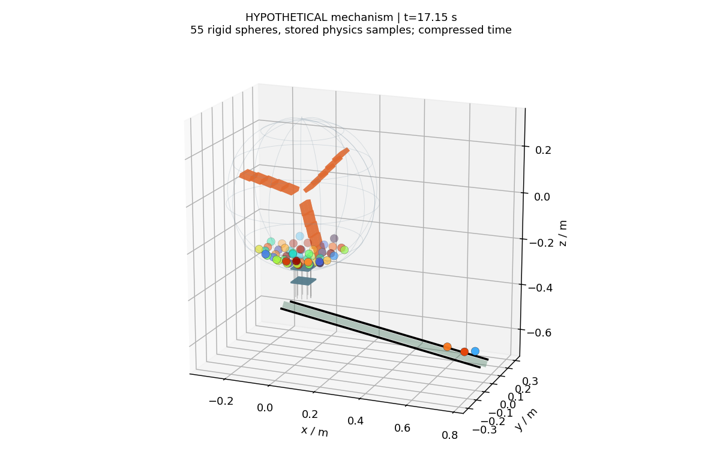
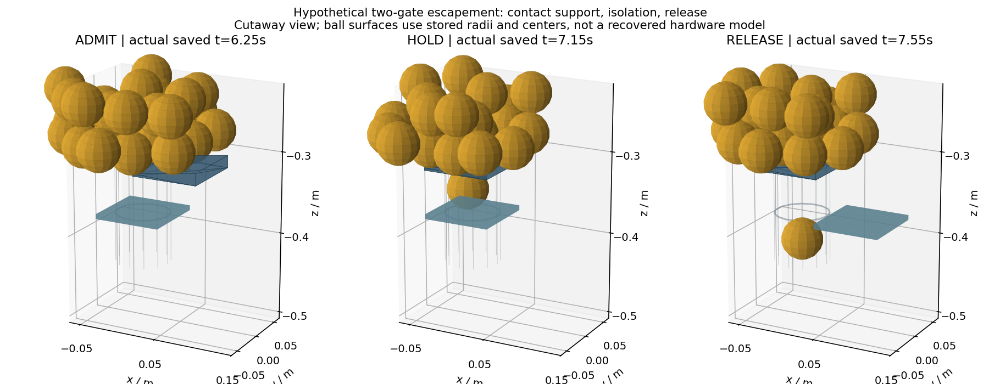
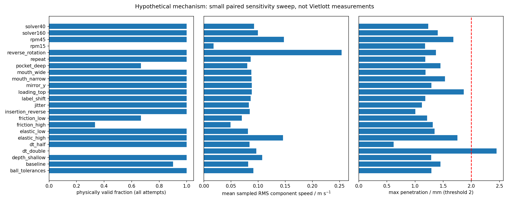
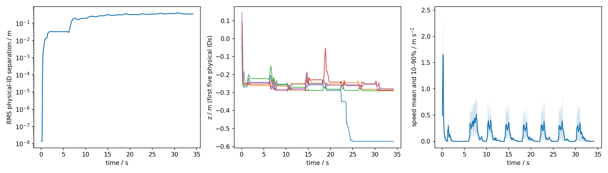

# FINAL DIGITAL TWIN HANDOFF — Power 6/55

Branch: `research/power655-physical-digital-twin`. Base Phase 4: `f329cab62a64c081d635eac8033a7029f7b4d51a`. Mã nguồn và dữ liệu trong `digital-twin/`; không merge master hoặc sửa các phiên bản được bảo vệ. Commit chính xác lấy từ GitHub permalink/Git log vì file không thể tự chứa SHA của chính commit mà không tạo vòng tự tham chiếu.

**Kết quả bàn giao: simulator vật lý 3D đã chạy và kiểm thử, cùng ensemble 78 lần chạy / 23 cấu hình. Đây là nền tảng nghiên cứu cơ khí giả định; chưa phải digital twin 1:1 có hiệu chuẩn của Vietlott. Không có bằng chứng tăng xác suất Jackpot hoặc dự báo ngoài mẫu.**

## 1. Mô hình vật lý đã xây dựng

PyBullet 3.2.7, Python 3.11.15; 55 rigid spheres tồn tại xuyên toàn bộ run; trọng lực 9,80665 m/s²; va chạm bóng–bóng/thành/tay gạt, ma sát, restitution, damping và rolling resistance. Shell cầu mesh concave tĩnh có độ dày và một lỗ đáy thật. Ba tay gạt cong xấp xỉ bằng chuỗi hộp trên khớp quay y có quán tính và giới hạn torque; motor có ramp tốc độ. Đây là topology giả định, không xác nhận máy dùng chung trục.

Cửa trên beveled + túi giữ một bóng + cửa dưới tạo escapement trọng lực. Chuỗi trạng thái `MIX → ADMIT → ISOLATE → HOLD → RELEASE → RESET`, sau bảy lần là `DONE`. Chỉ một bóng có tiếp xúc nâng đỡ với sàn túi được giữ; cửa trên có feedback dừng tiến khi độ xuyên tiếp xúc >=0,4 mm; cửa dưới nhả sau khi đóng cửa trên. Tiếp xúc với rãnh vật lý mới ghi nhận thu. Kẹt không được giải quyết bằng chọn bóng khác/xóa bóng. Không dùng nearest-ball picker, không teleport hoặc tắt va chạm của bóng thu.

Rãnh dốc, hai rail, chốt cuối cho sáu main và chốt riêng phía trước giữ special. **Sau sáu main còn 49; sau special còn 48**. Đây là hiệu chỉnh bắt buộc của tiêu chí “49 sau bảy” mâu thuẫn bảo toàn. Mỗi physical ID chỉ được thu một lần. Nhãn in gán bằng RNG riêng, độc lập với packing, thuộc tính và thứ tự tạo bodies.

Rãnh giả định rộng 92 mm có thể xếp main so le hai hàng; đây là cơ cấu giữ vật lý để kiểm thử, chưa tái dựng layout hiển thị/keeper của máy thật. Việc giữ đúng sáu main + special không xác nhận đúng hình học khay kết quả.

## 2. Thông số đã xác minh / documented

- 5/5 MP4 nguồn Phase 2 được băm lại, khớp toàn bộ SHA256. Không thêm video vào Git.
- 35 cận proxy bóng xuất hiện trên rãnh của Phase 2 được tái sử dụng, giữ PTS và interval arithmetic; số trúng không được đọc để fit vật lý.
- Quy định Vietlott 2017 ghi 55 bóng, ba tay, khoang cầu acrylic, thu bằng trọng lực; nominal 0,0505 ±0,001 m và 0,01234 ±0,000617 kg. Đây là **documented lịch sử**, chưa xác nhận cùng machine/ball-set 2026. Phiên này re-fetch PDF trả 403; nguồn đã pin và giới hạn nằm trong `source_review.md`.
- Pixel landmarks/tỷ lệ được ước lượng thủ công, chưa là đo SI. Model/serial, actual RPM, gate topology vẫn unknown.

## 3. Thông số giả định

Baseline: radius khoang 0,32 m, depth scale 1, wall 8 mm, arm length 0,275 m, motor request 25 RPM, torque 3 Nm, mouth radius 33 mm, pocket height 60 mm, gate speed 0,2 m/s, per-body friction 0,22, restitution 0,55, dt 0,0005 s, 80 iterations. Per-body restitution kết hợp trong Bullet nên 0,55/0,55 cho effective restitution 0,3025 trong fixture cô lập; không phải phép đo vật liệu thật.

**Motor request không phải tốc độ đạt được.** Mean tốc độ trục post-ramp trên 20 baseline runs chỉ **5.124 RPM**, so lệnh 25 RPM. Hệ thường stall/giảm tốc dưới tải của hình học giả định. Vì vậy sweep 15/45 là sweep **lệnh motor**, không phải bằng chứng máy thực chạy trong khoảng đó hoặc simulator đã duy trì RPM mong muốn. Đây là giới hạn động lực học quan trọng; trộn liên tục như broadcast chưa được tái hiện/hiệu chuẩn.

`parameter_registry.csv` ghi SI, nguồn, phạm vi, loại documented/assumed/estimated/unknown và độ bất định/range. Độ sâu/ma sát/đàn hồi/load/RPM/gate có sweep; một số construction constants chưa được sweep toàn diện và ghi rõ. Chỉ nominal ball mass/diameter có căn cứ lịch sử; phạm vi giả định không phải CI. Không sử dụng hai candidate 63,789 hoặc 94,904 RPM.

## 4. Nguồn tài liệu và khôi phục hình học

Xem [source_review.md](source_review.md), [input_inventory.csv](results/input_inventory.csv) và [geometry/reconstruction.md](geometry/reconstruction.md). Đã đọc handoff/protocol Phase 1–3, kế hoạch Phase 4, technical/unresolved tables, mã B1/C50/B7-100/B7-200. Không có physics prototype được tìm thấy trên bốn branch; mã mới được xây độc lập. Inventory không được gọi là một review khoa học độc lập của mọi annotation.

Smartplay Magnum nhắc Vietlott, Halogen là sản phẩm catalog khác; không nguồn nào định danh serial/model của Power trong năm video. Không gán thông số model tương tự cho máy Vietlott. Tìm kiếm bổ sung không thu được CAD/manual/biên bản kiểm định gắn đúng serial.

Landmarks trên native frame pilot 1098,030267 s và cận cơ cấu #01375 1113,512400 s có tọa độ/range trong `geometry/landmarks.csv`. Rim khoảng 841×875 px; hub khoảng 244 px, tỷ lệ bề rộng khoảng 0,290. Không dùng nominal ball diameter làm vật chuẩn vì thiếu liên kết bộ bóng và depth. Một ellipse/camera có cắt cảnh không xác định duy nhất metric scale, depth, refraction, trục hoặc cấu tạo cửa. `chamber.obj` là mesh va chạm tham số, không manufacturer CAD.

`mesh_quality.json`: raw shell 12960 triangles, 160 zero-area pole faces từ tham số hóa latitude/longitude. Bản hàn đỉnh `chamber_clean.obj` có 12800 triangles và manifold hai mặt trên mỗi cạnh, Euler characteristic 2. Sai lệch mặt phẳng lớn nhất so hình cầu giả định khoảng 0,477 mm; đây không phải sai số so máy thật. Bản clean không được thay vào engine giữa các run. Đổi mouth radius cũng đổi tessellation latitude, nên không tách hoàn toàn gate sensitivity khỏi sai số mesh.

## 5. Những gì simulator làm được

Chạy headless từ CLI; động lực học 55 bóng; mixer ba tay; cơ cấu admit/giữ/nhả; sáu main và special từ 49; lưu trạng thái và quỹ đạo 3D; xuất NPZ/CSV/GIF/PNG; numerical fixtures; forced-jam; Monte Carlo; paired sensitivity; kiểm nhãn/repeat/solver order; báo cáo từ run JSON đã lưu.

Seed 0 cuối: 7 captures, còn 48 bodies active, 48 còn vật lý trong khoang; xuyên lớn nhất 1.156 mm dưới ngưỡng 2 mm. Sphere thu vẫn nằm/va chạm trong rãnh.

## 6. Những gì chưa mô phỏng đúng / chưa được xác nhận

Chưa xác nhận hình học/trục/cửa/nạp, RPM/load response/timing, foam deformation, contact law từng bóng, CoM, electrostatic/aerodynamic/vibration/environment forces. Chưa có loading-port/rack trajectory thật; các bóng bắt đầu từ ensemble vị trí trong khoang. Hub/shaft housing dùng làm landmark ảnh nhưng chưa dựng solid collision volume đã nhận dạng; khoảng rỗng gốc tay gạt là đơn giản hóa chưa kiểm định. Gates là prescribed zero-mass actuators với feedback lý tưởng giả định, không model cơ cấu truyền động/độ trễ thật. Chưa có multi-camera 3D tracks để xác nhận mức độ trộn, vận tốc hoặc phân bố va chạm. Hình replay dùng marker tâm bóng; không phải mô hình quang học của acrylic. Việc qua kiểm thử engine không chứng minh tái hiện động lực học broadcast.

## 7. Numerical validation và physical validation

- Unit tests: **9 qua** (xem `validation/unit_tests.txt`).
- Isolated numerical checks: **9/9 qua**; động lượng, năng lượng đàn hồi, restitution kết hợp, overlap, first-order freefall convergence, frictional dissipation, frictionless energy, solver sensitivity. Ideal contactERP=0; driven full system có stabilization riêng. Không tuyên bố hệ có motor bảo toàn năng lượng.
- Full-system seed0 + forced jam: **14/14 qua**; body count89 gồm 55 bóng, no duplicate/escape/unauthorized exit, 49/48 đúng, no coincident centers và contact threshold. Jam aperture20 mm không thể cho bóng radius25,25 mm đi qua; hệ báo incomplete và giữ 55 bóng.
- Lịch sử lỗi được giữ: thử pocket đầu không thu được; elastic fixture tăng năng lượng số; initial sweep seed1004 bị upper gate xuyên4,104 mm. Sửa contact pause và velocity-consistent gates, rồi chạy lại final ensemble. Xem `validation/development_log.md`; không trộn old runs vào kết quả final.

Gate từng cấu hình trong ensemble vẫn áp dụng; một baseline pass không thay cho kiểm mọi cấu hình. Numerical distributional convergence chưa được chứng nhận từ ba paired seeds:

| Cấu hình | Paired seeds / cặp đủ main | Đổi mean main interval | Đổi RMS speed metric | Engineering gate |
|---|---:|---:|---:|---|
| dt_half | 3 / 3 | 0.53% | 7.38% | True |
| dt_double | 3 / 3 | 1.54% | 6.48% | False |
| solver40 | 3 / 3 | 1.91% | 1.93% | True |
| solver160 | 3 / 3 | 0.27% | 9.83% | True |
| mirror_y | 3 / 3 | 1.38% | 2.61% | True |

Ngưỡng engineering: interval<5%, speed<15%, tất cả paired runs phải qua physical gate2 mm. `mean_rms_speed_all_m_s` là RMS theo các thành phần vận tốc (full vector RMS =sqrt(3) lần metric này); biểu đồ velocity norm riêng dùng m/s thông thường. Kết quả finite ensemble chỉ là kiểm thăm dò, không chứng minh hội tụ phân bố xác suất.

## 8. Calibration / identifiability

Calibration01372–01373; validation01374–01375; reserve hồi cứu01376. Tất cả đã được xem trong nghiên cứu cũ, **không có holdout tương lai chưa xem**. Training mean downstream interval **13.124778 s**. Sai lệch mean kỳ validation: **0,085085 và 0,795795 s**; reserve hồi cứu0,442108 s. Các cận là độ phân giải định vị ảnh, không CI thời điểm cô lập.

Chỉ fit một summary cadence; `video_cadence.json` là kịch bản lịch yêu cầu có điều kiện, không verified controller period. RPM/ma sát/hình học/mass chưa được hiệu chuẩn. Reduced constant-latency observation model có rank1/6, minh họa không nhận dạng; đây **không phải Jacobian tính từ toàn bộ simulator**. Các cấu hình physics khác có thể cho cadence gần nhau dưới cùng lịch actuation. Không tối ưu theo số trúng hoặc báo forecast trên chính kỳ fit.

## 9. Monte Carlo thực thi

Final ensemble: **78 runs / 23 cấu hình**, tất cả kết quả tồn tại dưới `results/runs/`. Hoàn tất đủ bảy và qua toàn bộ physical gate là hai cột riêng. **66/78** run qua physical gate; baseline **18/20**. Binomial interval mô tả cho tỷ lệ valid baseline: [0.683, 0.988], chỉ dưới giả định mô hình/seed cố định. Tám seed1000–1007 đã có trong đợt development dùng sửa gate; 12 seed1008–1019 mới với controller sau sửa. Vì có tái sử dụng development, interval chưa điều chỉnh selection và không có bảo đảm coverage95% sau tuning; không gọi toàn nhóm20 là blind validation. Thời gian giữa main trên valid baseline: 3.985105555552043 s. Cấu hình baseline request4 s nhằm kiểm cơ cấu, không khớp thời gian video.

| Cấu hình | Runs | Đủ7 | Qua physical | Xuyên max mm | Mean main interval s, valid only |
|---|---:|---:|---:|---:|---:|
| ball_tolerances | 3 | 3 | 3 | 1.290 | 3.9458 |
| baseline | 20 | 18 | 18 | 1.453 | 3.9851 |
| depth_shallow | 3 | 3 | 3 | 1.288 | 3.9940 |
| dt_double | 3 | 3 | 0 | 2.448 | NA |
| dt_half | 3 | 3 | 3 | 0.619 | 3.9761 |
| elastic_high | 3 | 3 | 3 | 1.752 | 3.9604 |
| elastic_low | 3 | 3 | 3 | 1.347 | 4.0099 |
| friction_high | 3 | 1 | 1 | 1.317 | 3.6482 |
| friction_low | 3 | 2 | 2 | 1.213 | 4.0169 |
| insertion_reverse | 1 | 1 | 1 | 1.006 | 3.9828 |
| jitter | 1 | 1 | 1 | 1.121 | 4.0065 |
| label_shift | 1 | 1 | 1 | 1.181 | 3.9410 |
| loading_top | 3 | 3 | 3 | 1.865 | 4.0116 |
| mirror_y | 3 | 3 | 3 | 1.292 | 4.0096 |
| mouth_narrow | 3 | 3 | 3 | 1.531 | 4.7885 |
| mouth_wide | 3 | 3 | 3 | 1.185 | 3.9929 |
| pocket_deep | 3 | 2 | 2 | 1.453 | 4.0002 |
| repeat | 1 | 1 | 1 | 1.181 | 3.9410 |
| reverse_rotation | 3 | 3 | 3 | 1.371 | 4.0299 |
| rpm15 | 3 | 0 | 0 | 1.178 | NA |
| rpm45 | 3 | 3 | 3 | 1.680 | 4.0328 |
| solver160 | 3 | 3 | 3 | 1.403 | 3.9446 |
| solver40 | 3 | 3 | 3 | 1.234 | 4.0307 |

Không bỏ thất bại khỏi mẫu số completion. Timing valid-only có nhãn riêng. Run-level là đơn vị độc lập; các capture/frame trong run tương quan. 20 baseline seeds chưa đủ ước lượng bias nhỏ theo55 số; expected main count mỗi số chỉ khoảng2,18 nếu đủ20 runs. Không báo p-value chi-square tiệm cận trên bảng thưa.

## 10. Độ nhạy, hỗn loạn, đối xứng và bias

Sweep RPM15/45, ma sát thấp/cao + rolling resistance, restitution, mouth/pocket geometry, depth, loading, ball tolerances theo nominal lịch sử, reverse rotation, dt, solver iterations. Đây là các scenario cục bộ có paired seeds, không phải global Sobol analysis hoặc posterior calibration. Scenario friction đồng thời đổi rolling resistance; scenario tolerance đổi cả mass/diameter và khoảng cách packing. Vì vậy không tách riêng hiệu ứng nhân quả của từng biến trong các scenario kết hợp. `physical_property_diagnostics.json` chỉ mô tả thuộc tính giả định của bóng đã thu, chưa đủ để suy ra bias.

Exact label permutation: **True**. Same-seed repeat exact: **True**. Reverse insertion giữ cùng capture path: **False**; main physical-ID intersection 0/6. Đổi nhãn chỉ đổi metadata; đổi insertion order có thể đổi contact solving và trajectory hỗn loạn. Mirror-y được đánh giá riêng bằng paired summaries, không giả exact mirror dynamics khi solver/facets có khác thứ tự.

Một cặp perturbation ban đầu10^-7 m: RMS separation lớn nhất **0.396383 m**, cùng capture sequence **False**. Đây là finite-time divergence một cặp, không Lyapunov exponent đã fit.

### Chẩn đoán mô-men bổ sung sau ensemble chính

Sau khi thấy motor stall từ log, đã khóa một diagnostic riêng: torque30 Nm (10× giả định baseline), ba seed ghép1000–1002; không đổi baseline hoặc gộp vào78 run chính. Mô-men này là stress input giả định, không spec phần cứng. Protocol được ghi trước ba run này; đây là **post-hoc engineering diagnostic**, không kiểm định độc lập.

| Seed | Mean achieved RPM post-ramp | Captures | Xuyên max mm | Failures |
|---:|---:|---:|---:|---|
| 1000 | 5.720 | 7 | 1.167 | none |
| 1001 | 5.105 | 7 | 1.424 | none |
| 1002 | 4.500 | 7 | 1.453 | none |

`results/torque_diagnostic/summary.json` giữ cả ba baseline tương ứng để đối chiếu. Tăng lực không được dùng để ép thành công hoặc bỏ ngưỡng xuyên; nếu vẫn stall/vi phạm contact thì cần sửa/đo geometry và drivetrain, không coi motor command là actual RPM.

Trong diagnostic này cả 3 run thu đủ 7 và dưới 2 mm, nhưng mean đạt được chỉ4,50–5,72 RPM. Tăng torque 10× chưa giải quyết được tracking 25 RPM; chưa xác định riêng nguyên nhân từ geometry, contact law hay drivetrain. Không chọn diagnostic thành baseline “đã hiệu chuẩn”.

Mọi asymmetry hoặc fail thuộc hình học/parameter/loading/solver giả định cho đến khi có chứng cứ phần cứng. Nhãn được randomize độc lập nên tính exchangeability theo số là thuộc tính thiết kế kiểm code; nó không xác nhận công bằng của phần cứng. Tolerance scenario đổi lại thuộc tính theo seed, chưa đại diện cho một bộ bóng có sai lệch cố định gắn với số in qua nhiều kỳ. Muốn kiểm bias cố định theo số cần bảng thuộc tính và loading đúng của bộ bóng thật. **Không quy bias mô hình thành bias Vietlott. Selection probabilities chưa được chứng nhận.** Xem `validation/ensemble_diagnostics.json` và các đồ thị sensitivity/trajectories/pre_capture.

## 11. Đánh giá dự báo

Phân biệt bốn cấp: tạo7; tái hiện động lực học; phát hiện bias cơ học; dự báo xác suất trước draw. Chỉ cấp đầu và một số numerical/engineering checks được chứng minh. Ba cấp sau chưa qua gate. Không có pre-draw measured state hoặc holdout chưa xem; không chấm Jackpot giả và không chạy so B1/B7-100 bằng kết quả mô phỏng. Giao thức so sánh sáu vé/cùng draw/strict-past được ghi trong `experiments/predictive_boundary.md`; benchmark thực tế **chưa thực hiện vì thiếu đầu vào hợp lệ**.

## 12. Giới hạn vật lý và thống kê

Ngưỡng xuyên2 mm là engineering tolerance khoảng4% diameter, không sai số đo thật. Contact law và mesh discretization có thể tạo artifacts; timestep/iterations thay đổi trajectory. Ba seeds/config cho phần lớn sweep rất ít; baseline20 cũng không đủ bias inference theo số. Randomized label symmetry bảo vệ khỏi printed-number dependence trong code, không chứng minh fairness của mọi loading/material scenario. Cadence fit dễ bị actuation schedule chi phối; matching timing không chứng nhận mechanics. Mọi output mô phỏng có scope `hypothetical_model_only`.

## 13. Lệnh tái lập và tài sản

Từ `digital-twin/`, Python3.11 và `requirements.txt`:

```powershell
$py = 'C:/vietlott-digital-twin-env/Scripts/python.exe'
& $py -m pytest -q tests
& $py scripts/cli.py validate
& $py scripts/cli.py run --seed 0 --config configs/baseline.json --out results/seed0.json --trajectory results/seed0.npz
& $py scripts/cli.py monte-carlo --seeds 20 --start 1000 --out results/monte_carlo.json
& $py scripts/cli.py experiment
& $py -m scripts.torque_diagnostic
& $py scripts/cli.py report
& $py scripts/cli.py render --trajectory results/seed0.npz --out renders/seed0.gif
& $py scripts/cli.py export-tracks --trajectory results/seed0.npz --out results/trajectory_seed0.csv
& $py scripts/cli.py calibrate
& $py scripts/build_handoff.py
& $py scripts/audit.py
```

Simulator không cần video/GPU/GUI. GIF/PNG là render tự tạo; không commit MP4 nguồn. Runtime và hash binary trong `results/runtime.json`; config/implementation SHA nằm trong final run JSON; file manifest có audit riêng. Exact repeat chỉ kỳ vọng trên cùng môi trường binary, không giữa mọi hệ điều hành/build. Dữ liệu cũ và model bảo vệ được kiểm qua Git diff/hash, không merge master.






## 14. Dữ liệu thực tế còn thiếu và bước tiếp theo

1. Model/serial/revision; dimensioned CAD khoang/paddles/gate/loading port/rail; maintenance/replacement logs.
2. Ball-set ID, per-ball mass/diameter/roundness/CoM, material tests, replacement history.
3. Encoder/tachometer có timecode, motor acceleration/deceleration/load response, control signals và gate latency.
4. Master không cắt cảnh, calibrated synchronized multiview và close-up gate; exposure/refraction và dropped-frame information.
5. ID/vị trí/vận tốc 3D lúc nạp và trước capture; camera/track uncertainty được kiểm độc lập.
6. Thí nghiệm contact/friction/rolling/deformation và môi trường khi có căn cứ ảnh hưởng.
7. Cohort có đủ dữ liệu strict-past, ground truth độc lập và holdout tương lai khóa trước khi fit.

Tiếp tục bằng dữ liệu đo được cấp phép và controlled experiments; giữ simulator như testbed có thể kiểm toán. Không nâng mô hình thành hệ dự báo hoặc tuyên bố1:1 khi các gate còn thiếu.
